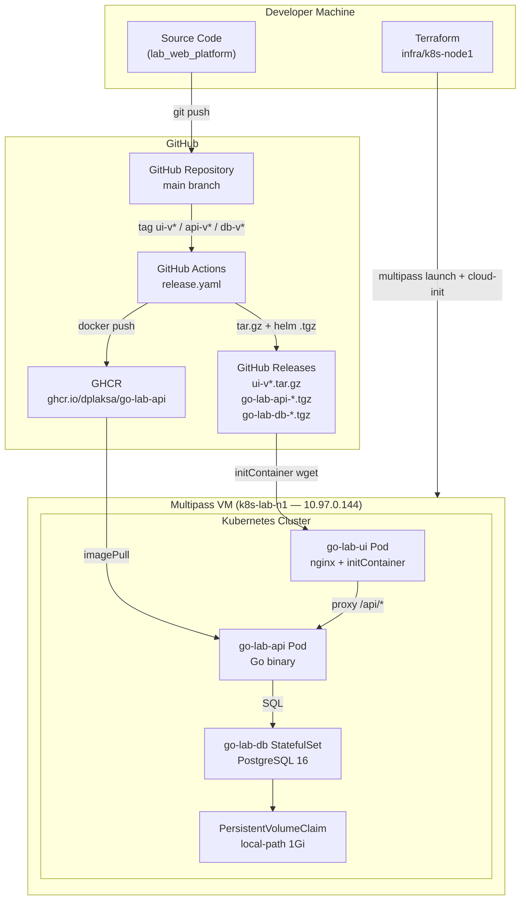

# Deployment Diagram

Shows the full deployment pipeline from code to running cluster.

## Infrastructure

| Component | Technology | Provisioner |
|---|---|---|
| VM | Ubuntu 26.04, 3 vCPU, 6GB RAM, 30GB disk | Terraform + Multipass |
| Kubernetes | v1.31, kubeadm | cloud-init |
| CNI | Flannel (VXLAN, 10.244.0.0/16) | cloud-init |
| Storage | local-path-provisioner | cloud-init |
| Package manager | Helm v3 | manual (planned: Flux CD) |
